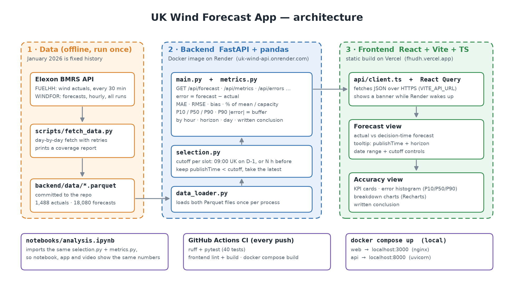

# UK Wind Forecast App

**Live app:** https://fhudh.vercel.app/  ·  **API:** https://uk-wind-api.onrender.com/docs

A UK energy supplier buys power a day ahead, and roughly buys *demand minus forecast wind*. A wrong wind forecast means buying too much or too little. This app shows them, for every decision made in January 2026:

1. **The forecast they actually had** at decision time: the latest WINDFOR forecast published before the cutoff on D-1 (default 09:00 UK time, configurable).
2. **How accurate those forecasts were** against actual wind generation (FUELHH): MAE, RMSE, bias, error percentiles, and the buffer needed for 90% confidence.

Decisions run 1–31 January 2026, so delivery days are **2 January – 1 February 2026**.

> The free Render backend sleeps when idle. The first request can take up to a minute; the app shows a banner while it wakes up.



## Folder structure

```
backend/                FastAPI + pandas API
  app/
    config.py           window dates, default cutoff, timezone
    data_loader.py      loads the Parquet files once per process
    selection.py        picks the decision-time forecast for every slot (core logic)
    metrics.py          MAE, RMSE, bias, percentiles, breakdowns, conclusion text
    schemas.py          response models
    main.py             API routes, CORS
  data/                 cached Elexon data (Parquet, committed)
  tests/                pytest: selection, metrics, API
  Dockerfile
frontend/               React + Vite + TypeScript + Recharts + React Query
  src/api/              API client, types, mock data
  src/components/       layout, filter bar (dates + cutoff), shared UI
  src/pages/            ForecastView.tsx (screen 1), Accuracy.tsx (screen 2)
  Dockerfile, nginx.conf, vercel.json
scripts/fetch_data.py   one-off download from Elexon BMRS into backend/data/
notebooks/analysis.ipynb  accuracy analysis, using the same selection + metrics code
docs/architecture.png   architecture diagram
docker-compose.yml      runs frontend + API together
render.yaml             Render config for the API
.github/workflows/      CI: ruff, pytest, frontend lint + build, docker build
```

## Run with Docker

```bash
docker compose up --build
```

- App: http://localhost:3000
- API docs: http://localhost:8000/docs

## Run locally (without Docker)

Needs Python 3.12 and Node 22.

Backend (terminal 1):

```bash
cd backend
python -m venv .venv
.venv\Scripts\activate          # macOS/Linux: source .venv/bin/activate
pip install -r requirements-dev.txt
uvicorn app.main:app --reload --port 8000    # API docs: http://localhost:8000/docs
pytest                                       # run the tests
```

Frontend (terminal 2):

```bash
cd frontend
npm install
copy .env.example .env          # macOS/Linux: cp .env.example .env
npm run dev                     # http://localhost:5173
```

`frontend/.env` sets `VITE_API_URL=http://localhost:8000`. Without it the frontend runs on built-in mock data and shows a "Mock data" badge.

## Data

Only the two required sources are used, both from [Elexon BMRS](https://bmrs.elexon.co.uk/):

| File | Source | Content |
| --- | --- | --- |
| `fuelhh_wind.parquet` | [FUELHH](https://bmrs.elexon.co.uk/api-documentation/endpoint/datasets/FUELHH/stream), `fuelType = WIND` | Actual wind generation, half-hourly (1,488 rows) |
| `windfor.parquet` | [WINDFOR](https://bmrs.elexon.co.uk/api-documentation/endpoint/datasets/WINDFOR/stream) | Wind forecasts, hourly, every publication (18,080 rows from 264 runs) |

January 2026 is fixed history, so the data is downloaded once and committed. The app never calls Elexon at runtime, so it is fast and does not break if Elexon is slow. To download it again (with the backend venv active):

```bash
python scripts/fetch_data.py    # fetches week by week with retries, prints a coverage report
```

## Forecast selection

For every half-hour delivery slot:

1. Work out the **cutoff**. Two modes:
   - **Decision time** (default): a clock time on D-1, in UK local time, e.g. 09:00 the day before delivery. Computed in `Europe/London`, so it stays correct across clock changes.
   - **Horizon**: N hours before the slot starts (up to 48 h).
2. Keep only forecasts with `publishTime` **strictly before** the cutoff. A forecast published exactly at the cutoff is too late.
3. Take the one with the **latest `publishTime`**, and record that `publishTime` and the horizon (slot start − publishTime).
4. Join to the actual on the same `startTime`.

**Missing data:** a slot with no eligible forecast or no actual stays empty (never zero) and is left out of the metrics. WINDFOR is hourly and FUELHH is half-hourly, so forecasts are compared on the hour (744 hourly pairs); the :30 slots have no forecast. The notebook checks the alternative (forecast vs the hourly mean of actuals): MAE changes by less than 1%.

### Default cutoff: 09:00 UK on D-1

GB day-ahead power is bought in auctions held the day before delivery:

| Auction | Gate closure (UK time, D-1) |
| --- | --- |
| [EPEX SPOT](https://www.epexspot.com/en/market-results) GB day-ahead, 60-minute | **09:20** |
| [Nord Pool N2EX](https://www.nordpoolgroup.com/en/trading/Day-ahead-trading/) GB day-ahead | **09:50** |

The default is 09:00, just before the earliest gate closure, leaving time to place bids. With this cutoff the 07:30 WINDFOR run on D-1 is used, so forecasts are about 16–40 hours ahead. Change it in the app's filter bar, or with `decision_time` / `horizon_h` on the API.

## Metrics

Error = **forecast − actual**, so a positive error means wind was over-forecast and the buyer bought too little.

| Metric | Meaning |
| --- | --- |
| MAE | Average size of the miss, in MW |
| RMSE | Like MAE but punishes big misses more |
| Bias | Average signed error: over- (+) or under-forecasting (−) |
| MAE % of mean | MAE divided by mean actual output |
| MAE % of capacity | MAE divided by peak observed output in the window (17,805 MW) |
| P10 / P50 / P90 | Percentiles of signed error: spread and skew |
| P90 of \|error\| | **The buffer:** "with 90% confidence, actual wind is within ±X MW of forecast" |

Breakdowns are given by time of day, forecast horizon, and delivery day.

**Why no MAPE:** wind output can be close to zero, and dividing by a tiny actual turns a small miss into a huge percentage. Percentages here divide by mean output or capacity instead.

## Key findings (09:00 D-1 cutoff, full window)

Full working in [`notebooks/analysis.ipynb`](notebooks/analysis.ipynb).

- **MAE 2,022 MW** (17.9% of mean output), RMSE 2,497 MW.
- **Bias +1,746 MW:** the forecast was too high in 85% of hours, so the buyer tends to buy too little.
- **Buffer:** in 90% of hours actual wind was within **±4,154 MW** of forecast. The risk is almost all on the shortfall side (signed P10 −426 MW, P90 +4,154 MW).
- **Horizon:** error grows slowly with horizon (about 1.2× from 6 h to 36 h ahead), but the bias is still about +1,500 MW even 1 hour ahead. That suggests a gap between what WINDFOR forecasts and what FUELHH meters (most likely curtailment), not just forecast skill. Removing the bias would cut MAE to about 1,376 MW.
- **Worst times:** 02:00–06:00 UK. **Worst days:** 28, 12 and 11 January; 28 Jan was a calm day where the forecast expected about twice the actual output.
- **Cutoff sensitivity:** 06:00 and 09:00 give almost the same accuracy. 12:00 is about 6% better but falls after both auctions close.

**What it means for buying:** shade the forecast down by the bias, then hold a buffer for shortfall of up to about 4 GW, larger overnight.

## Testing

```bash
cd backend
pytest        # 40 tests
ruff check . ../scripts
```

The selection tests cover the edge cases: forecast published exactly at the cutoff, slots with only late forecasts, missing actuals, half-hour slots with no hourly forecast, the 31 Jan decision for 1 Feb delivery, UK summer time, and horizon mode. CI (GitHub Actions) runs ruff, pytest, frontend lint and build, and `docker compose build` on every push.

## Deployment

- **Frontend:** Vercel, built from `frontend/` with `VITE_API_URL=https://uk-wind-api.onrender.com`.
- **API:** Render, running `backend/Dockerfile` (`render.yaml`), with `CORS_ORIGINS=https://fhudh.vercel.app`.

## Trade-offs and possible improvements

- **Cached data instead of live API calls:** reliable and fast for a fixed month; new months need the fetch script re-run. Next step: a scheduled fetch.
- **Strict cutoff and exact-hour join:** conservative and never invents data, but ignores the :30 actuals.
- **Render instead of Vercel serverless for the API:** pandas and pyarrow are heavy for serverless functions; the cost is a cold start on the free plan.
- **Capacity:** "% of capacity" uses peak observed output, because FUELHH only covers transmission-metered wind and nameplate capacity would understate the error.
- **Improvements:** a bias-corrected forecast, a rolling buffer recommendation updated daily, and checking the curtailment explanation against balancing-mechanism data.

## AI tools used

This project was built with help from **Claude Code** (Anthropic's AI coding assistant). It was used to plan the build, write and refactor code (backend, frontend, tests, Docker and CI config), build the analysis notebook and architecture diagram, and draft this README. I reviewed all of it, checked the selection rules and edge cases against the real data, and made the design decisions (cutoff default, join rule, metrics, deployment).
